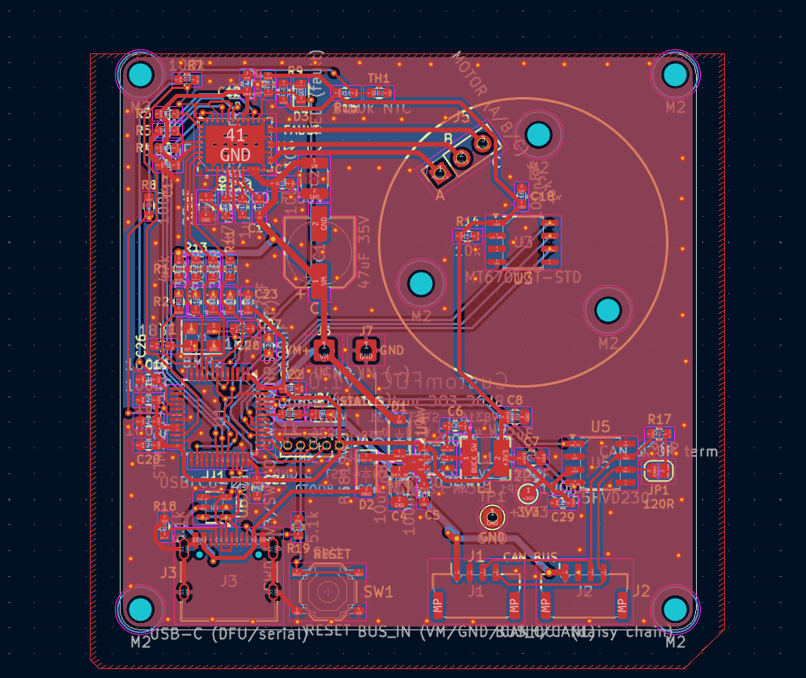

# CustomFOCBoard

A small motor driver board I'm building to run a 27 mm BLDC gimbal motor with field-oriented control. The motor mounts straight onto the board, with its magnet sitting over the encoder chip, so the whole thing ends up as one self-contained motor module you can talk to over CAN or USB.

Designed in KiCad 9, meant to be assembled by JLCPCB.

## What's on it

- STM32G431 microcontroller
- TI DRV8316C three-phase driver with built-in MOSFETs and current sensing
- MT6701 magnetic encoder for the rotor angle
- 3.3 V buck regulator that runs from either the motor supply or USB
- CAN transceiver with two JST-GH connectors, so several boards can be daisy-chained
- USB-C for flashing and serial, plus an SWD header
- Bus voltage and temperature sensing, fault and status LEDs, GND/3V3 test points

The board is 56 × 56 mm, two layers, with all parts on the top. It takes a 4.5–28 V motor supply.

## Some design choices

The DRV8316 is the hardware-configured variant, so everything is set with pins instead of over SPI. It runs in 3x PWM mode, which is what SimpleFOC expects. Current-sense gain is 1.2 V/A, and the slew rate is set to 50 V/µs. That's slower than the max, but cleaner for current measurements, and a small gimbal motor doesn't need more.

The three phase currents go through simple RC filters into the STM32's ADC. The encoder is read over SSI on SPI1.

One quirk: the STM32's BOOT0 pin is shared with CAN RX, which idles high. That means a blank chip boots straight into the USB DFU bootloader, which is handy for the first flash. After that, the option bytes need to be set so it boots from flash.

## Pin map

| Function | STM32 pins |
|---|---|
| PWM (TIM1) | PA8, PA9, PA10 |
| Phase currents (ADC1) | PA0, PA1, PA2 |
| Bus voltage / NTC | PA3 / PB0 |
| Driver nSLEEP / EN / nFAULT | PB2 / PB10 / PB12 |
| Encoder (SPI1) | CS PA15, CLK PB3, DO PB4 |
| CAN (FDCAN1) | RX PB8, TX PB9 |
| USB | PA11, PA12 |
| SWD | PA13, PA14 |
| Status LED | PB6 |

## Files

Open `CustomFOCBoard.kicad_pro` in KiCad 9. The custom symbol and footprint for the DRV8316 live in the project folder, so nothing extra needs to be installed. The JLCPCB BOM is in `CustomFOCBoard_BOM_JLCPCB.csv`. I generate gerbers with the [Fabrication Toolkit](https://github.com/bennymeg/Fabrication-Toolkit) plugin, so they aren't committed here.

## Status

The design is done, but not yet ordered. Next up is a 3D-printed fit check against the motor, then ordering boards and writing firmware with SimpleFOC.

You can also browse the design on [BoardRepo](https://boardrepo.com/kasperls004/customfocboard).
