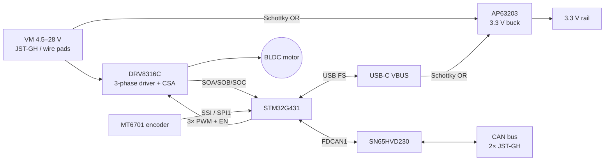

# CustomFOCBoard

A compact, single-board **field-oriented control (FOC) motor module** for a small BLDC gimbal motor. Driver, MCU, absolute encoder, current sensing, CAN bus and USB fit on one 56 × 56 mm two-layer board. The motor mounts directly on top, with its magnet centred over the encoder.

Designed in **KiCad 9** for assembly at **JLCPCB**. All parts are on the top side.


## Highlights

| | |
|---|---|
| **MCU** | STM32G431CBT6 (Cortex-M4F, 170 MHz), 8 MHz crystal |
| **Gate driver / power stage** | TI DRV8316C: 3-phase driver with integrated FETs and current-sense amplifiers |
| **Position sensor** | MagnTek MT6701 14-bit magnetic encoder over SSI, centred under the motor shaft |
| **Current sensing** | 3 inline phase currents from the DRV8316 CSAs (1.2 V/A), RC-filtered into ADC1 |
| **Supply** | 4.5–28 V motor supply (VM); AP63203 3.3 V buck, diode-OR'd from VM or USB VBUS |
| **Communication** | CAN (SN65HVD230) on two daisy-chainable JST-GH connectors, with jumper-selectable 120 Ω termination |
| **Programming** | USB-C (ROM DFU bootloader / USB-CDC) and a 1.27 mm SWD header |
| **Monitoring** | Bus-voltage divider, board NTC, fault and status LEDs |
| **Board** | 56 × 56 mm, 2 layers, 4 × M2 mounting holes, 3 × M2 motor mounting holes |

Target motor: 27 mm gimbal BLDC, 7 pole pairs, 12.5 Ω/phase. Firmware is planned on SimpleFOC (3-PWM mode).

## Block diagram



## Design notes

### DRV8316C configuration (hardware variant, pin-strapped)

| Pin | Strap | Result |
|---|---|---|
| MODE | 47 kΩ to AVDD | 3× PWM; INLx tied together as a phase-enable (DRV_EN) |
| GAIN | 0 Ω to AVDD | 1.2 V/A |
| VREF/ILIM | AVDD | CSA zero-current output at 1.65 V |
| SLEW | Hi-Z (open) | 50 V/µs, chosen for lower EMI and cleaner current samples |
| OCP/SR | GND | Overcurrent protection at the default level |
| VSEL_BK | GND | Internal buck in resistor mode (unused, populated per datasheet) |

The current-sense outputs pass through 330 Ω / 1 nF filters (≈ 480 kHz corner) before the ADC.

### A footprint bug caught before fabrication
The first custom footprint for the DRV8316's VQFN-40 (RGF0040E) package numbered the pins starting on a **short** side. The real package starts pin 1 on a **long** side, so every pin was shifted by eight positions, and the first board would have been dead on arrival. I caught it when the assembler's 3D preview put the pin-1 marker in the wrong place. I rebuilt the footprint and verified it pad for pad against TI's pin grouping, the LCSC/EasyEDA land pattern and an independent open-source design, then re-routed the driver area.

### STM32 pin map

| Function | Pins |
|---|---|
| PWM (TIM1 CH1–3) | PA8, PA9, PA10 |
| Phase current (ADC1) | PA0, PA1, PA2 |
| Bus voltage / NTC | PA3 / PB0 |
| DRV8316 control | nSLEEP PB2, EN PB10, nFAULT PB12 |
| Encoder (SPI1) | CS PA15, CLK PB3, DO PB4 |
| CAN (FDCAN1) | RX PB8, TX PB9 |
| USB | PA11, PA12 |
| SWD | PA13, PA14 |
| Status LED | PB6 |

PB8 doubles as BOOT0. CAN RX idles high, so a blank MCU starts in the ROM USB DFU bootloader. After the first flash, the `nSWBOOT0`/`nBOOT0` option bytes are set so the chip boots from flash.

### Bring-up aids
GND (through-hole loop pad) and 3V3 test points, a reset button, SWD, a fault LED tied to the driver's nFAULT, and a firmware-controlled status LED.

## Repository layout

```
CustomFOCBoard.kicad_pro / _sch / _pcb   KiCad 9 project
CustomFOCBoard.kicad_sym                 Project symbol (DRV8316CTRGFR)
CustomFOCBoard.pretty/                   Project footprint (RGF0040E VQFN-40)
CustomFOCBoard.kicad_dru                 Custom DRC rules (analog vs. switching-node clearance)
CustomFOCBoard_BOM_JLCPCB.csv            BOM with LCSC part numbers
fabrication-toolkit-options.json         Settings for the JLC Fabrication Toolkit plugin
docs/                                    Images
```

Open `CustomFOCBoard.kicad_pro` in KiCad 9. The project libraries resolve through `${KIPRJMOD}`, so nothing needs to be installed beyond KiCad's standard libraries. Gerbers, BOM and placement files are generated with the [Fabrication Toolkit](https://github.com/bennymeg/Fabrication-Toolkit) plugin and are not committed.

## Status

- [x] Schematic and layout complete
- [ ] Final DRC/ERC pass on the latest revision
- [x] BOM and placement data prepared for JLCPCB assembly
- [ ] Mechanical fit check against the motor (3D-printed mock-up)
- [ ] Fabrication and bring-up
- [ ] Firmware (SimpleFOC on STM32G4: FOC current control, CAN command interface)

The design is also browsable on [BoardRepo](https://boardrepo.com/kasperls004/customfocboard).
